  

<h2 align="center">Hi 👋, I'm Kongphop</h2>
<h4 align="center">UX/UI Designer & Full-Stack Developer · Software Engineering @ Mae Fah Luang University</h4>

  

---

<h3 align="center">🚀 About Me</h3>

I'm a **4th-year Software Engineering student at Mae Fah Luang University** (Chiang Rai, Thailand). I'm passionate about **UX/UI design and frontend development**, and I can also **design and build the backend** behind the screens.

I like owning a feature from end to end: talking to users, sketching the flow, designing the UI in Figma, building it in React or React Native, and then wiring it up to APIs and a database that actually hold up.

- 🎨 **Design:** user flows, wireframes, prototypes, clean and consistent UI
- 💻 **Frontend:** React, React Native (Expo), TypeScript
- ⚙️ **Backend:** Java Spring Boot, REST APIs, Firebase, SQL databases
- 🌱 **Currently building:** *TalentTrail*, a recruiter/HR dashboard with AI resume matching (capstone project)
- 🧑‍🏫 Teaching Assistant for the **Database Systems** course at MFU

 

---

<h3 align="center">🤝 Connect</h3>

  
  <!-- TODO: add LinkedIn / Gmail badges -->
  <!--  -->
  <!--  -->

---

<h3 align="center">💻 Tech Stack</h3>

<b>Languages</b> 
  

<b>Frontend & Design</b> 
  

<b>Backend & Database</b> 
  

<b>Tools</b> 
  

---

<h3 align="center">📂 Featured Projects</h3>

  
  
  

---

<h3 align="center">📊 GitHub Stats</h3>

  

<h3 align="center">🐍 Commit Activity</h3>

  <picture>
    <source media="(prefers-color-scheme: dark)" srcset="https://raw.githubusercontent.com/kongphop555/kongphop555/output/github-contribution-grid-snake-dark.svg" />
    <source media="(prefers-color-scheme: light)" srcset="https://raw.githubusercontent.com/kongphop555/kongphop555/output/github-contribution-grid-snake.svg" />
    
  </picture>

---

<h3 align="center">⌘ Philosophy</h3>

<i>"Good design is invisible. Good code is maintainable."</i>

  

<h2 align="center">Hi 👋, I'm Kongphop</h2>
<h4 align="center">UX/UI Designer & Full-Stack Developer · Software Engineering @ Mae Fah Luang University</h4>

  

---

<h3 align="center">🚀 About Me</h3>

I'm a **4th-year Software Engineering student at Mae Fah Luang University** (Chiang Rai, Thailand). I'm passionate about **UX/UI design and frontend development**, and I can also **design and build the backend** behind the screens.

I like owning a feature from end to end: talking to users, sketching the flow, designing the UI in Figma, building it in React or React Native, and then wiring it up to APIs and a database that actually hold up.

- 🎨 **Design:** user flows, wireframes, prototypes, clean and consistent UI
- 💻 **Frontend:** React, React Native (Expo), TypeScript
- ⚙️ **Backend:** Java Spring Boot, REST APIs, Firebase, SQL databases
- 🌱 **Currently building:** *TalentTrail*, a recruiter/HR dashboard with AI resume matching (capstone project)
- 🧑‍🏫 Teaching Assistant for the **Database Systems** course at MFU

 

---

<h3 align="center">🤝 Connect</h3>

  
  <!-- TODO: add LinkedIn / Gmail badges -->
  <!--  -->
  <!--  -->

---

<h3 align="center">💻 Tech Stack</h3>

<b>Languages</b> 
  

<b>Frontend & Design</b> 
  

<b>Backend & Database</b> 
  

<b>Tools</b> 
  

---

<h3 align="center">📂 Featured Projects</h3>

  
  
  

---

<h3 align="center">📊 GitHub Stats</h3>

  

<h3 align="center">📈 Activity Graph</h3>

  

<h3 align="center">🐍 Commit Activity</h3>

  <picture>
    <source media="(prefers-color-scheme: dark)" srcset="https://raw.githubusercontent.com/kongphop555/kongphop555/output/github-contribution-grid-snake-dark.svg" />
    <source media="(prefers-color-scheme: light)" srcset="https://raw.githubusercontent.com/kongphop555/kongphop555/output/github-contribution-grid-snake.svg" />
    
  </picture>

---

<h3 align="center">⌘ Philosophy</h3>

<i>"Good design is invisible. Good code is maintainable."</i>

